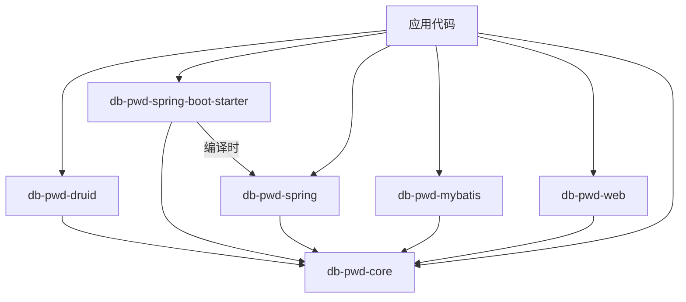

# 集成场景和方案

> 文档版本: v1.0
> 最后更新: 2026-02-11

## 概述

本文档描述数据库密码管理系统在不同技术栈和场景下的集成方案。根据应用使用的框架和技术架构，提供了6种主要的集成方式，覆盖了从轻量级JDBC应用到企业级Spring应用的各类场景。

---

## 集成方案分类

根据技术栈和应用架构，集成方案可分为以下几类：

| 分类 | 集成方案 | 适用场景 | 基础依赖 | 额外模块 |
|-----|---------|---------|---------|---------|
| **连接池集成** | Druid DruidPasswordCallback | 已使用Druid连接池的应用 | db-pwd-core + Druid | db-pwd-druid |
| **Spring生态** | Spring Boot Starter | Spring Boot应用 | db-pwd-core + Spring Boot | db-pwd-spring-boot-starter |
| **Spring生态** | Spring BeanPostProcessor | 传统Spring应用（XML/Java配置） | db-pwd-core + Spring | db-pwd-spring |
| **ORM框架** | MyBatis/iBatis DataSourceFactory | 纯MyBatis应用（无Spring） | db-pwd-core + MyBatis | db-pwd-mybatis |
| **纯JDBC** | StandalonePasswordDecryptor | 纯JDBC应用或工具类库 | db-pwd-core | 无 |
| **Web框架** | Struts/Servlet InitListener | Struts或纯Servlet应用 | db-pwd-core + Struts/Servlet | db-pwd-web |

---

## 1. Druid DruidPasswordCallback 集成方案

### 方案概述

利用Druid连接池内置的密码回调机制，在Druid初始化DataSource时自动解密密码。这是使用Druid连接池应用的最推荐方式，无需额外包装。

### 技术特点

- ✅ **零侵入**：利用Druid原生机制，完全透明
- ✅ **高兼容性**：兼容Druid所有配置方式
- ✅ **自动解密**：密码解密在连接池初始化时自动完成
- ✅ **性能最优**：无需装饰器包装，直接使用Druid

### 架构设计

```
┌─────────────────────────────────────┐
│    DruidDataSource 配置            │
│  jdbcUrl, username, password        │
│  password: "占位符/db_id"           │
└─────────────┬───────────────────────┘
              │
              ▼
┌─────────────────────────────────────┐
│  DruidPasswordCallback              │
│  - 拦截密码回调                     │
│  - 读取 db.pwd 和 sm4.key           │
│  - 解密密文密码                     │
└─────────────┬───────────────────────┘
              │
              ▼
┌─────────────────────────────────────┐
│  返回解密后的明文密码               │
└─────────────┬───────────────────────┘
              │
              ▼
┌─────────────────────────────────────┐
│      Druid连接池正常初始化          │
└─────────────────────────────────────┘
```

### 实现设计

#### 模块结构

**模块名称**: `db-pwd-druid`

**依赖关系**:
```xml
<dependency>
    <groupId>com.dbpwd</groupId>
    <artifactId>db-pwd-core</artifactId>
    <version>1.0.0</version>
</dependency>
<dependency>
    <groupId>com.alibaba</groupId>
    <artifactId>druid</artifactId>
    <version>1.2.20</version>
    <scope>provided</scope>
</dependency>
```

#### 核心类

```java
package com.dbpwd.druid;

/**
 * Druid连接池密码回调处理器
 * 负责在Druid初始化时拦截密码字段并自动解密
 */
public class DruidPasswordCallback extends DruidDataSource.PasswordCallback {

    private static final Logger logger = LoggerFactory.getLogger(DruidPasswordCallback.class);

    // 密码文件和密钥文件路径
    private String passwordFilePath;
    private String keyFilePath;

    /**
     * 构造函数
     *
     * @param passwordFilePath 密码文件路径
     * @param keyFilePath 密钥文件路径
     */
    public DruidPasswordCallback(String passwordFilePath, String keyFilePath) {
        this.passwordFilePath = passwordFilePath;
        this.keyFilePath = keyFilePath;
    }

    @Override
    protected char[] getPassword() {
        try {
            // 1. 获取占位符（数据库名或ID）
            String dbId = super.getPassword() != null ? super.getPassword().toString() : null;

            if (dbId == null || dbId.trim().isEmpty()) {
                throw new IllegalArgumentException("密码占位符不能为空，请配置数据库ID");
            }

            // 2. 使用PasswordService获取解密密码
            PasswordService passwordService = new PasswordServiceImpl(passwordFilePath, keyFilePath);
            String plainPassword = passwordService.getDecryptedPassword(dbId);

            logger.info("成功解密数据库 {} 的密码", dbId);

            // 3. 返回明文密码
            return plainPassword.toCharArray();

        } catch (Exception e) {
            logger.error("解密数据库密码失败", e);
            throw new RuntimeException("数据库密码解密失败: " + e.getMessage(), e);
        }
    }

    /**
     * 工厂方法：创建并配置DruidDataSource
     *
     * @param dbId 数据库ID（作为密码占位符）
     * @param dbConfig 数据库配置
     * @param passwordFilePath 密码文件路径
     * @param keyFilePath 密钥文件路径
     * @return 配置好的DruidDataSource
     */
    public static DruidDataSource createDataSource(
            String dbId,
            DatabaseConfig dbConfig,
            String passwordFilePath,
            String keyFilePath) {

        DruidDataSource dataSource = new DruidDataSource();

        // 设置基本配置
        dataSource.setUrl(dbConfig.getJdbcUrl());
        dataSource.setUsername(dbConfig.getUsername());
        dataSource.setPassword(dbId);  // 使用dbId作为占位符
        dataSource.setDriverClassName(dbConfig.getDriverClassName());

        // 设置密码回调
        dataSource.setPasswordCallback(new DruidPasswordCallback(passwordFilePath, keyFilePath));

        // 设置连接池参数（可选）
        setPoolParameters(dataSource);

        return dataSource;
    }

    /**
     * 设置Druid连接池基础参数
     */
    private static void setPoolParameters(DruidDataSource dataSource) {
        dataSource.setInitialSize(5);
        dataSource.setMinIdle(5);
        dataSource.setMaxActive(20);
        dataSource.setMaxWait(60000);
        dataSource.setTimeBetweenEvictionRunsMillis(60000);
        dataSource.setMinEvictableIdleTimeMillis(300000);
        dataSource.setTestWhileIdle(true);
        dataSource.setTestOnBorrow(false);
        dataSource.setTestOnReturn(false);
        dataSource.setValidationQuery("SELECT 1");
    }
}
```

### 使用方式

#### 方式1：Java配置

```java
@Configuration
public class DruidDataSourceConfig {

    @Value("${dbpwd.password-file:~/.dbpwd/db.pwd}")
    private String passwordFilePath;

    @Value("${dbpwd.key-file:~/.dbpwd/sm4.key}")
    private String keyFilePath;

    @Bean
    public DataSource dataSource() {
        // 使用dbId作为密码占位符
        String dbId = "prod_db_main";

        // 从db.pwd读取数据库配置
        DatabaseConfig dbConfig = getDatabaseConfig(dbId);

        // 创建配置了密码回调的Druid数据源
        return DruidPasswordCallback.createDataSource(
            dbId, dbConfig, passwordFilePath, keyFilePath
        );
    }
}
```

#### 方式2：Spring Boot配置（自动配置）

```yaml
# application.yml
spring:
  datasource:
    type: com.alibaba.druid.pool.DruidDataSource
    druid:
      url: jdbc:h2:mem:acdb_main
      username: app_user
      password: prod_db_main  # 使用数据库ID作为占位符
      driver-class-name: com.mysql.cj.jdbc.Driver
      password-callback-class: com.dbpwd.druid.DruidPasswordCallback
      password-callback-args:
        password-file: ~/.dbpwd/db.pwd
        key-file: ~/.dbpwd/sm4.key

dbpwd:
  druid:
    enabled: true
    password-file: ~/.dbpwd/db.pwd
    key-file: ~/.dbpwd/sm4.key
```

#### 方式3：纯Java使用

```java
public class SimpleDruidExample {
    public static void main(String[] args) throws Exception {
        // 创建带密码回调的Druid数据源
        DruidDataSource dataSource = DruidPasswordCallback.createDataSource(
            "prod_db_main",  // 数据库ID（密码占位符）
            new DatabaseConfig(
                "jdbc:h2:mem:acdb_main",
                "sa",
                "org.h2.Driver"
            ),
            "~/.dbpwd/db.pwd",
            "~/.dbpwd/sm4.key"
        );

        try (Connection conn = dataSource.getConnection();
             Statement stmt = conn.createStatement();
             ResultSet rs = stmt.executeQuery("SELECT COUNT(*) FROM user")) {

            if (rs.next()) {
                System.out.println("User count: " + rs.getInt(1));
            }
        }
    }
}
```

### 优势与限制

| 优势 | 说明 |
|-----|------|
| 原生支持 | 使用Druid内置机制，无需额外包装 |
| 零侵入 | 对现有Druid配置最小化改动 |
| 性能最优 | 无额外代理开销 |

| 限制 | 说明 |
|-----|------|
| 仅限Druid | 只适用于使用Druid连接池的应用 |
| 配置稍复杂 | 需要配置密码回调类 |

---

## 2. Spring Boot Starter 集成方案

### 方案概述

提供Spring Boot Starter自动配置，通过spring.factories机制自动装配密码管理相关Bean，实现最小化配置的Spring Boot集成。

### 技术特点

- ✅ **自动配置**：通过spring.factories实现零配置启动
- ✅ **配置属性**：提供application.yml配置支持
- ✅ **条件装配**：基于@ConditionalOnProperty按需激活
- ✅ **多数据源**：支持多数据源场景

### 架构设计

```
┌─────────────────────────────────────────┐
│   Spring Boot 应用启动                  │
│   application.yml                       │
│   dbpwd.enabled: true                    │
└─────────────┬───────────────────────────┘
              │
              ▼
┌─────────────────────────────────────────┐
│   自动配置触发                           │
│   DbPwdAutoConfiguration                │
│   @ConditionalOnProperty(enabled)       │
└─────────────┬───────────────────────────┘
              │
              ▼
┌─────────────────────────────────────────┐
│   注册Beans                             │
│   - PasswordService                     │
│   - DataSourceDecorator                 │
│   - DataSourceInitializer               │
└─────────────┬───────────────────────────┘
              │
              ▼
┌─────────────────────────────────────────┐
│   DataSource自动解密                    │
│   拦占DataSource初始化，解密密码        │
└─────────────────────────────────────────┘
```

### 实现设计

#### 模块结构

**模块名称**: `db-pwd-spring-boot-starter`

**目录结构**:
```
db-pwd-spring-boot-starter/
├── pom.xml
└── src/main/
    ├── java/com/dbpwd/boot/
    │   ├── autoconfigure/
    │   │   └── DbPwdAutoConfiguration.java
    │   ├── properties/
    │   │   └── DbPwdProperties.java
    │   └── decorator/
    │       └── DataSourceDecorator.java
    └── resources/
        └── META-INF/
            └── spring.factories
```

#### 依赖关系

```xml
<dependencies>
    <dependency>
        <groupId>com.dbpwd</groupId>
        <artifactId>db-pwd-core</artifactId>
        <version>1.0.0</version>
    </dependency>
    <dependency>
        <groupId>org.springframework.boot</groupId>
        <artifactId>spring-boot-autoconfigure</artifactId>
    </dependency>
    <dependency>
        <groupId>org.springframework.boot</groupId>
        <artifactId>spring-boot-configuration-processor</artifactId>
        <optional>true</optional>
    </dependency>
    <dependency>
        <groupId>org.springframework</groupId>
        <artifactId>spring-jdbc</artifactId>
    </dependency>
</dependencies>
```

#### 核心类

##### 1. 配置属性类

```java
package com.dbpwd.boot.properties;

import org.springframework.boot.context.properties.ConfigurationProperties;

/**
 * Database Password Manager 配置属性
 */
@ConfigurationProperties(prefix = "dbpwd")
public class DbPwdProperties {

    /**
     * 是否启用DBPWD功能
     */
    private boolean enabled = false;

    /**
     * 密码文件路径
     */
    private String passwordFile = "~/.dbpwd/db.pwd";

    /**
     * 密钥文件路径
     */
    private String keyFile = "~/.dbpwd/sm4.key";

    /**
     * 是否启用自动装饰DataSource
     */
    private boolean autoDecorate = true;

    /**
     * 密码占位符前缀（可选）
     */
    private String passwordPlaceholder;

    // Getters and Setters
    public boolean isEnabled() { return enabled; }
    public void setEnabled(boolean enabled) { this.enabled = enabled; }
    public String getPasswordFile() { return passwordFile; }
    public void setPasswordFile(String passwordFile) { this.passwordFile = passwordFile; }
    public String getKeyFile() { return keyFile; }
    public void setKeyFile(String keyFile) { this.keyFile = keyFile; }
    public boolean isAutoDecorate() { return autoDecorate; }
    public void setAutoDecorate(boolean autoDecorate) { this.autoDecorate = autoDecorate; }
    public String getPasswordPlaceholder() { return passwordPlaceholder; }
    public void setPasswordPlaceholder(String passwordPlaceholder) { this.passwordPlaceholder = passwordPlaceholder; }
}
```

##### 2. 自动配置类

```java
package com.dbpwd.boot.autoconfigure;

import com.dbpwd.core.service.PasswordService;
import com.dbpwd.core.service.impl.PasswordServiceImpl;
import com.dbpwd.boot.properties.DbPwdProperties;
import com.dbpwd.boot.decorator.DataSourceDecorator;
import org.springframework.boot.autoconfigure.AutoConfigureAfter;
import org.springframework.boot.autoconfigure.condition.ConditionalOnClass;
import org.springframework.boot.autoconfigure.condition.ConditionalOnProperty;
import org.springframework.boot.autoconfigure.condition.ConditionalOnProperty;
import org.springframework.boot.autoconfigure.jdbc.DataSourceAutoConfiguration;
import org.springframework.boot.context.properties.EnableConfigurationProperties;
import org.springframework.context.annotation.Bean;
import org.springframework.context.annotation.Configuration;
import org.springframework.context.annotation.Primary;

import javax.sql.DataSource;

/**
 * Database Password Manager Spring Boot 自动配置
 */
@Configuration
@ConditionalOnClass({PasswordService.class})
@ConditionalOnProperty(prefix = "dbpwd", name = "enabled", havingValue = "true")
@EnableConfigurationProperties(DbPwdProperties.class)
@AutoConfigureAfter(DataSourceAutoConfiguration.class)
public class DbPwdAutoConfiguration {

    /**
     * 创建密码服务Bean
     */
    @Bean
    public PasswordService passwordService(DbPwdProperties properties) throws Exception {
        return new PasswordServiceImpl(
            expandPath(properties.getPasswordFile()),
            expandPath(properties.getKeyFile())
        );
    }

    /**
     * 创建DataSource装饰器Bean
     */
    @Bean
    public DataSourceDecorator dataSourceDecorator(
            PasswordService passwordService,
            DbPwdProperties properties) {
        return new DataSourceDecorator(passwordService, properties);
    }

    /**
     * 装饰DataSource Bean（当autoDecorate=true时）
     */
    @Bean
    @Primary
    @ConditionalOnProperty(prefix = "dbpwd", name = "auto-decorate", havingValue = "true")
    public DataSource decoratedDataSource(
            DataSource originalDataSource,
            DataSourceDecorator decorator) {
        return decorator.decorate(originalDataSource);
    }

    /**
     * 展开路径中的~符号
     */
    private String expandPath(String path) {
        if (path.startsWith("~/")) {
            return System.getProperty("user.home") + path.substring(1);
        }
        return path;
    }
}
```

##### 3. DataSource装饰器

```java
package com.dbpwd.boot.decorator;

import com.dbpwd.core.model.DatabaseEntry;
import com.dbpwd.core.service.PasswordService;
import com.dbpwd.core.util.ENCFormat;
import com.dbpwd.boot.properties.DbPwdProperties;
import org.slf4j.Logger;
import org.slf4j.LoggerFactory;

import javax.sql.DataSource;
import java.lang.reflect.InvocationHandler;
import java.lang.reflect.Method;
import java.lang.reflect.Proxy;

/**
 * DataSource 装饰器
 * 拦截DataSource的密码字段并自动解密
 */
public class DataSourceDecorator {

    private static final Logger logger = LoggerFactory.getLogger(DataSourceDecorator.class);

    private final PasswordService passwordService;
    private final DbPwdProperties properties;

    public DataSourceDecorator(PasswordService passwordService, DbPwdProperties properties) {
        this.passwordService = passwordService;
        this.properties = properties;
    }

    /**
     * 装饰DataSource
     */
    public DataSource decorate(DataSource originalDataSource) {
        if (originalDataSource == null) {
            return null;
        }

        try {
            // 尝试获取当前密码
            String currentPassword = getPasswordFromDataSource(originalDataSource);

            // 如果密码是加密格式或占位符，则解密
            if (needDecrypt(currentPassword)) {
                String decryptedPassword = decryptPassword(currentPassword);
                setDecryptedPassword(originalDataSource, decryptedPassword);
                logger.info("成功解密DataSource的密码");
            }

        } catch (Exception e) {
            logger.warn("DataSource密码解密失败，继续使用原密码", e);
        }

        return originalDataSource;
    }

    /**
     * 判断密码是否需要解密
     */
    private boolean needDecrypt(String password) {
        if (password == null || password.isEmpty()) {
            return false;
        }

        // 检查是否为ENC格式
        if (ENCFormat.isEncrypted(password)) {
            return true;
        }

        // 检查是否为占位符格式
        if (properties.getPasswordPlaceholder() != null) {
            return password.startsWith(properties.getPasswordPlaceholder());
        }

        // 默认：检查是否在db.pwd中有对应的ID
        return passwordService.getConfig(password) != null;
    }

    /**
     * 解密密码
     */
    private String decryptPassword(String encryptedOrPlaceholder) throws Exception {
        // 如果是ENC格式，使用标准解密
        if (ENCFormat.isEncrypted(encryptedOrPlaceholder)) {
            return PasswordDecryptor.decrypt(encryptedOrPlaceholder, passwordService.getSm4Key());
        }

        // 如果是占位符，通过PasswordService解密
        DatabaseEntry entry = passwordService.getConfig(encryptedOrPlaceholder);
        if (entry == null) {
            throw new IllegalArgumentException("未找到数据库配置: " + encryptedOrPlaceholder);
        }

        return passwordService.getDecryptedPassword(encryptedOrPlaceholder);
    }

    /**
     * 从DataSource获取当前密码
     */
    private String getPasswordFromDataSource(DataSource dataSource) throws Exception {
        if (dataSource instanceof DruidDataSource) {
            return ((DruidDataSource) dataSource).getPassword();
        } else if (dataSource instanceof HikariDataSource) {
            return ((HikariDataSource) dataSource).getPassword();
        } else {
            // 使用反射获取password属性
            try {
                Method getPassword = dataSource.getClass().getMethod("getPassword");
                return (String) getPassword.invoke(dataSource);
            } catch (Exception e) {
                logger.warn("无法获取DataSource的密码字段", e);
                return null;
            }
        }
    }

    /**
     * 将解密后的密码设置到DataSource
     */
    private void setDecryptedPassword(DataSource dataSource, String decryptedPassword) throws Exception {
        if (dataSource instanceof DruidDataSource) {
            ((DruidDataSource) dataSource).setPassword(decryptedPassword);
        } else if (dataSource instanceof HikariDataSource) {
            // HikariCP的密码是final的，需要重新创建
            logger.warn("HikariCP需要重新创建数据源来更新密码");
        } else {
            // 使用反射设置password属性
            try {
                Method setPassword = dataSource.getClass().getMethod("setPassword", String.class);
                setPassword.invoke(dataSource, decryptedPassword);
            } catch (Exception e) {
                logger.warn("无法设置DataSource的密码字段", e);
            }
        }
    }
}
```

#### spring.factories配置

```properties
# src/main/resources/META-INF/spring.factories
org.springframework.boot.autoconfigure.EnableAutoConfiguration=\
com.dbpwd.boot.autoconfigure.DbPwdAutoConfiguration
```

### 使用方式

#### 最小化配置

```yaml
# application.yml
dbpwd:
  enabled: true
  # 文件路径有默认值，可省略
  # password-file: ~/.dbpwd/db.pwd
  # key-file: ~/.dbpwd/sm4.key

spring:
  datasource:
    url: jdbc:mysql://192.168.1.100:3306/acdb_main
    username: app_user
    password: prod_db_main  # 使用数据库ID作为占位符
    driver-class-name: com.mysql.cj.jdbc.Driver
```

#### 完整配置

```yaml
dbpwd:
  enabled: true
  auto-decorate: true
  password-file: /secure/dbpwd/db.pwd
  key-file: /secure/dbpwd/sm4.key
  password-placeholder: "ENC:"  # 可选：自定义占位符前缀

spring:
  datasource:
    url: jdbc:mysql://192.168.1.100:3306/acdb_main
    username: app_user
    password: ENC:prod_db_main  # 使用自定义前缀
    driver-class-name: com.mysql.cj.jdbc.Driver
    type: com.alibaba.druid.pool.DruidDataSource

    # Druid配置
    druid:
      initial-size: 5
      min-idle: 5
      max-active: 20
```

#### 多数据源配置

```java
@Configuration
public class MultiDataSourceConfig {

    @Primary
    @Bean
    @ConfigurationProperties(prefix = "spring.datasource.primary")
    public DataSource primaryDataSource() {
        return DataSourceBuilder.create().build();
    }

    @Bean
    @ConfigurationProperties(prefix = "spring.datasource.secondary")
    public DataSource secondaryDataSource() {
        return DataSourceBuilder.create().build();
    }

    @Bean
    public PasswordService passwordService(DbPwdProperties properties) throws Exception {
        return new PasswordServiceImpl(properties.getPasswordFile(), properties.getKeyFile());
    }

    // 自动配置会装饰以上两个DataSource
}
```

### 优势与限制

| 优势 | 说明 |
|-----|------|
| 零配置 | spring.factories自动装配 |
| 配置属性 | application.yml友好 |
| 多数据源 | 支持多数据源自动装饰 |

| 限制 | 说明 |
|-----|------|
| Spring Boot | 仅适用于Spring Boot应用 |
| 框架依赖 | 依赖Spring Boot框架 |

---

## 3. Spring BeanPostProcessor 集成方案

### 方案概述

使用Spring的BeanPostProcessor机制，在Bean实例化后、初始化前后自动处理DataSource类型的Bean，实现传统Spring应用（XML配置或Java配置）的密码自动解密。

### 技术特点

- ✅ **传统Spring**：适用于Spring 3.x/4.x/5.x等非Boot应用
- ✅ **Bean处理**：自动拦截所有DataSource Bean
- ✅ **灵活配置**：支持排除特定DataSource
- ✅ **Spring兼容**：兼容XML和Java配置方式

### 架构设计

```
┌─────────────────────────────────────┐
│   Spring 容器启动                   │
│   加载XML/Java配置                  │
└─────────────┬───────────────────────┘
              │
              ▼
┌─────────────────────────────────────┐
│   Bean实例化阶段                    │
│   创建DataSource Bean实例           │
└─────────────┬───────────────────────┘
              │
              ▼
┌─────────────────────────────────────┐
│   BeanPostProcessor执行             │
│   1. postProcessBeforeInitialization│
│   2. postProcessAfterInitialization │
└─────────────┬───────────────────────┘
              │
              ▼
┌─────────────────────────────────────┐
│   检测DataSource类型                │
│   拦截密码字段                       │
│   读取db.pwd解密                     │
│   设置解密后的密码                   │
└─────────────────────────────────────┘
```

### 实现设计

#### 模块结构

**模块名称**: `db-pwd-spring`

**目录结构**:
```
db-pwd-spring/
├── pom.xml
└── src/main/java/com/dbpwd/spring/
    ├── processor/
    │   └── DataSourcePasswordProcessor.java
    ├── config/
    │   └── DbPwdSpringConfiguration.java
    └── util/
        └── PasswordUtils.java
```

#### 依赖关系

```xml
<dependencies>
    <dependency>
        <groupId>com.dbpwd</groupId>
        <artifactId>db-pwd-core</artifactId>
        <version>1.0.0</version>
    </dependency>
    <dependency>
        <groupId>org.springframework</groupId>
        <artifactId>spring-context</artifactId>
    </dependency>
    <dependency>
        <groupId>org.springframework</groupId>
        <artifactId>spring-jdbc</artifactId>
    </dependency>
</dependencies>
```

#### 核心类

##### 1. BeanPostProcessor

```java
package com.dbpwd.spring.processor;

import com.dbpwd.core.service.PasswordService;
import com.dbpwd.core.service.impl.PasswordServiceImpl;
import org.slf4j.Logger;
import org.slf4j.LoggerFactory;
import org.springframework.beans.BeansException;
import org.springframework.beans.factory.config.BeanPostProcessor;
import org.springframework.context.ApplicationContext;
import org.springframework.context.ApplicationContextAware;

import javax.sql.DataSource;
import java.lang.reflect.Method;
import java.util.HashSet;
import java.util.Set;

/**
 * DataSource密码处理器
 * 通过BeanPostProcessor自动解密DataSource的密码
 */
public class DataSourcePasswordProcessor implements BeanPostProcessor, ApplicationContextAware {

    private static final Logger logger = LoggerFactory.getLogger(DataSourcePasswordProcessor.class);

    private ApplicationContext applicationContext;

    // 配置参数
    private String passwordFile = "~/.dbpwd/db.pwd";
    private String keyFile = "~/.dbpwd/sm4.key";

    // 排除的Bean名称
    private Set<String> excludedBeanNames = new HashSet<>();

    // 密码服务
    private PasswordService passwordService;

    public DataSourcePasswordProcessor() {
        initializePasswordService();
    }

    public DataSourcePasswordProcessor(String passwordFile, String keyFile) {
        this.passwordFile = passwordFile;
        this.keyFile = keyFile;
        initializePasswordService();
    }

    private void initializePasswordService() {
        try {
            String expandedPasswordFile = expandPath(passwordFile);
            String expandedKeyFile = expandPath(keyFile);
            this.passwordService = new PasswordServiceImpl(expandedPasswordFile, expandedKeyFile);
        } catch (Exception e) {
            logger.error("初始化PasswordService失败", e);
            throw new RuntimeException("初始化密码服务失败", e);
        }
    }

    @Override
    public Object postProcessBeforeInitialization(Object bean, String beanName) throws BeansException {
        // DataSource在初始化前处理
        if (bean instanceof DataSource) {
            processDataSourcePassword((DataSource) bean, beanName, "before");
        }
        return bean;
    }

    @Override
    public Object postProcessAfterInitialization(Object bean, String beanName) throws BeansException {
        // DataSource在初始化后二次处理（防止配置覆盖）
        if (bean instanceof DataSource) {
            processDataSourcePassword((DataSource) bean, beanName, "after");
        }
        return bean;
    }

    /**
     * 处理DataSource密码
     */
    private void processDataSourcePassword(DataSource dataSource, String beanName, String phase) {
        // 检查是否在排除列表中
        if (excludedBeanNames.contains(beanName)) {
            logger.debug("跳过排除的DataSource Bean: {}", beanName);
            return;
        }

        try {
            // 获取当前密码
            String currentPassword = getPassword(dataSource);

            // 检查是否需要解密
            if (needDecrypt(currentPassword)) {
                String decryptedPassword = decrypt(currentPassword);

                // 设置解密后的密码
                setPassword(dataSource, decryptedPassword);

                logger.info("成功解密DataSource Bean [{}] 的密码 (phase: {})", beanName, phase);
            }

        } catch (Exception e) {
            logger.warn("处理DataSource Bean [{}] 密码失败 (phase: {})", beanName, phase, e);
        }
    }

    /**
     * 检查密码是否需要解密
     */
    private boolean needDecrypt(String password) {
        if (password == null || password.isEmpty()) {
            return false;
        }

        // 检查是否为占位符（数据库ID）
        return passwordService.getConfig(password) != null;
    }

    /**
     * 解密密码
     */
    private String decrypt(String dbId) throws Exception {
        return passwordService.getDecryptedPassword(dbId);
    }

    /**
     * 获取DataSource的密码
     */
    private String getPassword(DataSource dataSource) throws Exception {
        // 尝试已知实现
        if (dataSource instanceof DruidDataSource) {
            return ((DruidDataSource) dataSource).getPassword();
        }

        // 使用反射
        try {
            Method method = dataSource.getClass().getMethod("getPassword");
            return (String) method.invoke(dataSource);
        } catch (Exception e) {
            logger.debug("无法获取DataSource的密码字段", e);
            return null;
        }
    }

    /**
     * 设置DataSource的密码
     */
    private void setPassword(DataSource dataSource, String password) throws Exception {
        // 尝试已知实现
        if (dataSource instanceof DruidDataSource) {
            ((DruidDataSource) dataSource).setPassword(password);
            return;
        }

        // 使用反射
        try {
            Method method = dataSource.getClass().getMethod("setPassword", String.class);
            method.invoke(dataSource, password);
        } catch (Exception e) {
            logger.debug("无法设置DataSource的密码字段", e);
        }
    }

    /**
     * 添加排除的Bean名称
     */
    public void addExcludedBean(String beanName) {
        excludedBeanNames.add(beanName);
    }

    /**
     * 展开路径中的~符号
     */
    private String expandPath(String path) {
        if (path.startsWith("~/")) {
            return System.getProperty("user.home") + path.substring(1);
        }
        return path;
    }

    @Override
    public void setApplicationContext(ApplicationContext applicationContext) throws BeansException {
        this.applicationContext = applicationContext;
    }

    public void setPasswordFile(String passwordFile) {
        this.passwordFile = passwordFile;
        initializePasswordService();
    }

    public void setKeyFile(String keyFile) {
        this.keyFile = keyFile;
        initializePasswordService();
    }
}
```

##### 2. Spring配置类

```java
package com.dbpwd.spring.config;

import com.dbpwd.spring.processor.DataSourcePasswordProcessor;
import org.springframework.context.annotation.Bean;
import org.springframework.context.annotation.Configuration;

/**
 * DBPWD Spring 配置类
 */
@Configuration
public class DbPwdSpringConfiguration {

    /**
     * 创建DataSource密码处理器Bean
     */
    @Bean
    public DataSourcePasswordProcessor dataSourcePasswordProcessor() {
        // 可以通过配置文件注入参数
        return new DataSourcePasswordProcessor();
    }

    /**
     * 创建自定义配置的密码处理器
     */
    @Bean
    public DataSourcePasswordProcessor customDataSourcePasswordProcessor(
            @org.springframework.beans.factory.annotation.Value("${dbpwd.password-file:~/.dbpwd/db.pwd}") String passwordFile,
            @org.springframework.beans.factory.annotation.Value("${dbpwd.key-file:~/.dbpwd/sm4.key}") String keyFile) {
        return new DataSourcePasswordProcessor(passwordFile, keyFile);
    }
}
```

### 使用方式

#### XML配置方式

```xml
<!-- applicationContext.xml -->
<?xml version="1.0" encoding="UTF-8"?>
<beans xmlns="http://www.springframework.org/schema/beans"
       xmlns:xsi="http://www.w3.org/2001/XMLSchema-instance"
       xmlns:context="http://www.springframework.org/schema/context"
       xsi:schemaLocation="
           http://www.springframework.org/schema/beans
           http://www.springframework.org/schema/beans/spring-beans.xsd
           http://www.springframework.org/schema/context
           http://www.springframework.org/schema/context/spring-context.xsd">

    <!-- 启用注解配置 -->
    <context:annotation-config/>

    <!-- 配置DBPWD -->
    <bean id="dataSourcePasswordProcessor" class="com.dbpwd.spring.processor.DataSourcePasswordProcessor">
        <property name="passwordFile" value="~/.dbpwd/db.pwd"/>
        <property name="keyFile" value="~/.dbpwd/sm4.key"/>
    </bean>

    <!-- 配置DataSource（密码使用数据库ID作为占位符） -->
    <bean id="dataSource" class="com.alibaba.druid.pool.DruidDataSource" destroy-method="close">
        <property name="url" value="jdbc:mysql://192.168.1.100:3306/acdb_main"/>
        <property name="username" value="app_user"/>
        <property name="password" value="prod_db_main"/>
        <property name="driverClassName" value="com.mysql.cj.jdbc.Driver"/>
        <property name="initialSize" value="5"/>
        <property name="minIdle" value="5"/>
        <property name="maxActive" value="20"/>
    </bean>

</beans>
```

#### Java配置方式

```java
@Configuration
public class AppConfig {

    @Value("${dbpwd.password-file:~/.dbpwd/db.pwd}")
    private String passwordFile;

    @Value("${dbpwd.key-file:~/.dbpwd/sm4.key}")
    private String keyFile;

    /**
     * 配置密码处理器
     */
    @Bean
    public DataSourcePasswordProcessor dataSourcePasswordProcessor() {
        DataSourcePasswordProcessor processor = new DataSourcePasswordProcessor(passwordFile, keyFile);

        // 可选：排除特定Bean
        // processor.addExcludedBean("testDataSource");

        return processor;
    }

    /**
     * 配置DataSource（密码使用占位符）
     */
    @Bean
    public DataSource dataSource() {
        DruidDataSource dataSource = new DruidDataSource();
        dataSource.setUrl("jdbc:mysql://192.168.1.100:3306/acdb_main");
        dataSource.setUsername("app_user");
        dataSource.setPassword("prod_db_main");  // 占位符
        dataSource.setDriverClassName("com.mysql.cj.jdbc.Driver");
        dataSource.setInitialSize(5);
        dataSource.setMinIdle(5);
        dataSource.setMaxActive(20);
        return dataSource;
    }

    /**
     * 配置JdbcTemplate
     */
    @Bean
    public JdbcTemplate jdbcTemplate(DataSource dataSource) {
        return new JdbcTemplate(dataSource);
    }

    /**
     * 配置MyBatis SqlSessionFactory
     */
    @Bean
    public SqlSessionFactory sqlSessionFactory(DataSource dataSource) throws Exception {
        SqlSessionFactoryBean factoryBean = new SqlSessionFactoryBean();
        factoryBean.setDataSource(dataSource);
        factoryBean.setTypeAliasesPackage("com.example.entity");
        factoryBean.setMapperLocations(new PathMatchingResourcePatternResolver()
            .getResources("classpath:mapper/*.xml"));
        return factoryBean.getObject();
    }
}
```

#### 属性文件配置

```properties
# dbpwd.properties
dbpwd.password-file=~/.dbpwd/db.pwd
dbpwd.key-file=~/.dbpwd/sm4.key

# 可选：排除某些DataSource Bean
dbpwd.excluded-beans=testDataSource,secondaryDataSource
```

### 优势与限制

| 优势 | 说明 |
|-----|------|
| 传统Spring | 支持Spring 3.x/4.x/5.x |
| XML/Java | 支持XML和Java配置 |
| 自动处理 | 自动拦截所有DataSource |

| 限制 | 说明 |
|-----|------|
| Spring依赖 | 需要Spring容器 |
| 反射限制 | 某些DataSource实现可能不支持 |

---

## 4. MyBatis/iBatis(无Spring) DataSourceFactory 集成方案

### 方案概述

通过继承MyBatis/iBatis的UnpooledDataSourceFactory，实现DataSource创建时的密码自动解密，适用于不使用Spring的纯MyBatis应用。

### 技术特点

- ✅ **纯MyBatis**：适用于非Spring的MyBatis应用
- ✅ **Factory模式**：利用MyBatis的DataSourceFactory机制
- ✅ **自动解密**：DataSource创建时自动解密密码
- ✅ **无依赖**：无需Spring容器

### 架构设计

```
┌─────────────────────────────────────┐
│   MyBatis配置文件                    │
│   mybatis-config.xml                 │
│   <dataSource type="DbPwdFactory"/>  │
└─────────────┬───────────────────────┘
              │
              ▼
┌─────────────────────────────────────┐
│   UnpooledDataSourceFactory         │
│   （基类，MyBatis内置）              │
└─────────────┬───────────────────────┘
              │
              ▼
┌─────────────────────────────────────┐
│   DbPwdDataSourceFactory            │
│   （继承UnpooledDataSourceFactory）  │
│   - 读取db.pwd和sm4.key              │
│   - 解密密码                         │
│   - 创建DataSource                  │
└─────────────┬───────────────────────┘
              │
              ▼
┌─────────────────────────────────────┐
│   返回配置好的DataSource             │
└─────────────────────────────────────┘
```

### 实现设计

#### 模块结构

**模块名称**: `db-pwd-mybatis`

**目录结构**:
```
db-pwd-mybatis/
├── pom.xml
└── src/main/java/com/dbpwd/mybatis/
    ├── factory/
    │   └── DbPwdDataSourceFactory.java
    └── config/
        └── MyBatisConfiguration.java
```

#### 依赖关系

```xml
<dependencies>
    <dependency>
        <groupId>com.dbpwd</groupId>
        <artifactId>db-pwd-core</artifactId>
        <version>1.0.0</version>
    </dependency>
    <dependency>
        <groupId>org.mybatis</groupId>
        <artifactId>mybatis</artifactId>
        <version>3.5.14</version>
        <scope>provided</scope>
    </dependency>
</dependencies>
```

#### 核心类

##### DataSourceFactory实现

```java
package com.dbpwd.mybatis.factory;

import com.dbpwd.core.service.PasswordService;
import com.dbpwd.core.service.impl.PasswordServiceImpl;
import org.apache.ibatis.datasource.unpooled.UnpooledDataSource;
import org.apache.ibatis.datasource.unpooled.UnpooledDataSourceFactory;

import javax.sql.DataSource;
import java.util.Properties;

/**
 * DBPWD DataSourceFactory
 * 继承MyBatis的UnpooledDataSourceFactory，实现密码自动解密
 */
public class DbPwdDataSourceFactory extends UnpooledDataSourceFactory {

    private static final Logger logger = LoggerFactory.getLogger(DbPwdDataSourceFactory.class);

    // 配置参数
    private String passwordFile = "~/.dbpwd/db.pwd";
    private String keyFile = "~/.dbpwd/sm4.key";

    // 密码服务
    private PasswordService passwordService;

    public DbPwdDataSourceFactory() {
        initializePasswordService();
    }

    /**
     * 初始化密码服务
     */
    private void initializePasswordService() {
        try {
            String expandedPasswordFile = expandPath(passwordFile);
            String expandedKeyFile = expandPath(keyFile);
            this.passwordService = new PasswordServiceImpl(expandedPasswordFile, expandedKeyFile);
        } catch (Exception e) {
            logger.error("初始化PasswordService失败", e);
            throw new RuntimeException("初始化密码服务失败", e);
        }
    }

    /**
     * 覆盖父类方法，创建带解密密码的DataSource
     */
    @Override
    public DataSource getDataSource() {
        Properties properties = getProperties();

        // 获取配置的参数
        String driver = properties.getProperty("driver");
        String url = properties.getProperty("url");
        String username = properties.getProperty("username");
        String password = properties.getProperty("password");

        // 解密密码（如果需要）
        String decryptedPassword = decryptPassword(password);

        // 直接设置到父类的dataSource
        if (dataSource == null) {
            dataSource = new UnpooledDataSource();
        }

        if (dataSource instanceof UnpooledDataSource) {
            UnpooledDataSource unpooledDataSource = (UnpooledDataSource) dataSource;
            if (driver != null) unpooledDataSource.setDriver(driver);
            if (url != null) unpooledDataSource.setUrl(url);
            if (username != null) unpooledDataSource.setUsername(username);
            if (decryptedPassword != null) unpooledDataSource.setPassword(decryptedPassword);

            logger.info("成功创建带解密密码的DataSource");
        }

        return dataSource;
    }

    /**
     * 解密密码
     */
    private String decryptPassword(String encryptedOrPlaceholder) {
        if (encryptedOrPlaceholder == null || encryptedOrPlaceholder.isEmpty()) {
            return null;
        }

        try {
            // 检查是否为占位符（数据库ID）
            if (passwordService.getConfig(encryptedOrPlaceholder) != null) {
                return passwordService.getDecryptedPassword(encryptedOrPlaceholder);
            }

            // 检查是否为ENC格式
            if (encryptedOrPlaceholder.startsWith("ENC(SM4:")) {
                return PasswordDecryptor.decrypt(encryptedOrPlaceholder, passwordService.getSm4Key());
            }

            // 返回明文（无需解密）
            logger.debug("密码不是占位符或加密格式，使用明文");
            return encryptedOrPlaceholder;

        } catch (Exception e) {
            logger.error("解密密码失败", e);
            throw new RuntimeException("密码解密失败", e);
        }
    }

    /**
     * 展开路径中的~符号
     */
    private String expandPath(String path) {
        if (path.startsWith("~/")) {
            return System.getProperty("user.home") + path.substring(1);
        }
        return path;
    }

    /**
     * Setter方法（用于MyBatis配置）
     */
    public void setPasswordFile(String passwordFile) {
        this.passwordFile = passwordFile;
        initializePasswordService();
    }

    public void setKeyFile(String keyFile) {
        this.keyFile = keyFile;
        initializePasswordService();
    }
}
```

##### DruidDataSourceFactory（可选，支持连接池）

```java
package com.dbpwd.mybatis.factory;

import com.alibaba.druid.pool.DruidDataSource;
import com.dbpwd.core.service.PasswordService;
import com.dbpwd.core.service.impl.PasswordServiceImpl;
import org.apache.ibatis.datasource.DataSourceFactory;

import javax.sql.DataSource;
import java.util.Properties;

/**
 * DBPWD Druid DataSourceFactory
 * 支持Druid连接池的密码自动解密
 */
public class DbPwdDruidDataSourceFactory implements DataSourceFactory {

    private static final Logger logger = LoggerFactory.getLogger(DbPwdDruidDataSourceFactory.class);

    // 配置参数
    private String passwordFile = "~/.dbpwd/db.pwd";
    private String keyFile = "~/.dbpwd/sm4.key";

    // 密码服务
    private PasswordService passwordService;

    private DruidDataSource dataSource;

    public DbPwdDruidDataSourceFactory() {
        initializePasswordService();
    }

    private void initializePasswordService() {
        try {
            String expandedPasswordFile = expandPath(passwordFile);
            String expandedKeyFile = expandPath(keyFile);
            this.passwordService = new PasswordServiceImpl(expandedPasswordFile, expandedKeyFile);
        } catch (Exception e) {
            logger.error("初始化PasswordService失败", e);
            throw new RuntimeException("初始化密码服务失败", e);
        }
    }

    @Override
    public void setProperties(Properties properties) {
        if (dataSource == null) {
            dataSource = new DruidDataSource();
        }

        // 设置基本属性
        if (properties.containsKey("driver")) {
            dataSource.setDriverClassName(properties.getProperty("driver"));
        }
        if (properties.containsKey("url")) {
            dataSource.setUrl(properties.getProperty("url"));
        }
        if (properties.containsKey("username")) {
            dataSource.setUsername(properties.getProperty("username"));
        }

        // 解密密码
        if (properties.containsKey("password")) {
            String encryptedOrPlaceholder = properties.getProperty("password");
            String decryptedPassword = decryptPassword(encryptedOrPlaceholder);
            dataSource.setPassword(decryptedPassword);
        }

        // 设置连接池参数（可选）
        if (properties.containsKey("initialSize")) {
            dataSource.setInitialSize(Integer.parseInt(properties.getProperty("initialSize")));
        }
        if (properties.containsKey("minIdle")) {
            dataSource.setMinIdle(Integer.parseInt(properties.getProperty("minIdle")));
        }
        if (properties.containsKey("maxActive")) {
            dataSource.setMaxActive(Integer.parseInt(properties.getProperty("maxActive")));
        }
    }

    @Override
    public DataSource getDataSource() {
        return dataSource;
    }

    private String decryptPassword(String encryptedOrPlaceholder) {
        if (encryptedOrPlaceholder == null || encryptedOrPlaceholder.isEmpty()) {
            return null;
        }

        try {
            if (passwordService.getConfig(encryptedOrPlaceholder) != null) {
                return passwordService.getDecryptedPassword(encryptedOrPlaceholder);
            }

            if (encryptedOrPlaceholder.startsWith("ENC(SM4:")) {
                return PasswordDecryptor.decrypt(encryptedOrPlaceholder, passwordService.getSm4Key());
            }

            return encryptedOrPlaceholder;

        } catch (Exception e) {
            logger.error("解密密码失败", e);
            throw new RuntimeException("密码解密失败", e);
        }
    }

    private String expandPath(String path) {
        if (path.startsWith("~/")) {
            return System.getProperty("user.home") + path.substring(1);
        }
        return path;
    }

    public void setPasswordFile(String passwordFile) {
        this.passwordFile = passwordFile;
        initializePasswordService();
    }

    public void setKeyFile(String keyFile) {
        this.keyFile = keyFile;
        initializePasswordService();
    }
}
```

### 使用方式

#### MyBatis XML配置

```xml
<!-- mybatis-config.xml -->
<?xml version="1.0" encoding="UTF-8" ?>
<!DOCTYPE configuration PUBLIC "-//mybatis.org//DTD Config 3.0//EN"
    "http://mybatis.org/dtd/mybatis-3-config.dtd">

<configuration>

    <!-- 配置数据源（使用DbPwdDataSourceFactory） -->
    <environments default="development">
        <environment id="development">
            <transactionManager type="JDBC"/>
            <dataSource type="com.dbpwd.mybatis.factory.DbPwdDataSourceFactory">
                <property name="driver" value="org.h2.Driver"/>
                <property name="url" value="jdbc:h2:mem:acdb_main"/>
                <property name="username" value="sa"/>
                <property name="password" value="prod_db_main"/>

                <!-- 可选：配置密钥文件路径 -->
                <property name="passwordFile" value="~/.dbpwd/db.pwd"/>
                <property name="keyFile" value="~/.dbpwd/sm4.key"/>
            </dataSource>
        </environment>
    </environments>

    <!-- Mapper配置 -->
    <mappers>
        <mapper resource="mapper/UserMapper.xml"/>
    </mappers>

</configuration>
```

#### Druid连接池配置

```xml
<!-- mybatis-config.xml -->
<configuration>

    <environments default="development">
        <environment id="development">
            <transactionManager type="JDBC"/>
            <dataSource type="com.dbpwd.mybatis.factory.DbPwdDruidDataSourceFactory">
                <property name="driver" value="org.h2.Driver"/>
                <property name="url" value="jdbc:h2:mem:acdb_main"/>
                <property name="username" value="sa"/>
                <property name="password" value="prod_db_main"/>

                <!-- 连接池参数 -->
                <property name="initialSize" value="5"/>
                <property name="minIdle" value="5"/>
                <property name="maxActive" value="20"/>

                <!-- 密钥文件配置 -->
                <property name="passwordFile" value="~/.dbpwd/db.pwd"/>
                <property name="keyFile" value="~/.dbpwd/sm4.key"/>
            </dataSource>
        </environment>
    </environments>

</configuration>
```

#### Java代码使用

```java
import org.apache.ibatis.io.Resources;
import org.apache.ibatis.session.SqlSession;
import org.apache.ibatis.session.SqlSessionFactory;
import org.apache.ibatis.session.SqlSessionFactoryBuilder;

public class MyBatisExample {
    public static void main(String[] args) throws Exception {
        // 读取MyBatis配置
        String resource = "mybatis-config.xml";
        InputStream inputStream = Resources.getResourceAsStream(resource);

        // 创建SqlSessionFactory
        SqlSessionFactory sqlSessionFactory = new SqlSessionFactoryBuilder()
            .build(inputStream);

        // 打开Session
        try (SqlSession session = sqlSessionFactory.openSession()) {

            // 获取Mapper
            UserMapper mapper = session.getMapper(UserMapper.class);

            // 执行查询
            List<User> users = mapper.findAll();
            for (User user : users) {
                System.out.println(user);
            }
        }
    }
}
```

### 优势与限制

| 优势 | 说明 |
|-----|------|
| 纯MyBatis | 无需Spring容器 |
| 工厂模式 | 符合MyBatis设计 |
| 连接池 | 支持Druid连接池 |

| 限制 | 说明 |
|-----|------|
| MyBatis依赖 | 仅适用于MyBatis应用 |
| 配置复杂 | 需要配置factory类型 |

---

## 5. 纯JDBC StandalonePasswordDecryptor 集成方案

### 方案概述

提供独立的密码解密工具类，适用于纯JDBC应用、工具类库或轻量级应用。该方案位于db-pwd-core模块中，无需额外依赖。

### 技术特点

- ✅ **无框架依赖**：纯JDK实现
- ✅ **轻量级**：只依赖db-pwd-core
- ✅ **易集成**：API简单直观
- ✅ **工具友好**：适合命令行工具等场景

### 架构设计

```
┌─────────────────────────────────────┐
│   应用代码                           │
│   需要获取数据库连接                 │
└─────────────┬───────────────────────┘
              │
              ▼
┌─────────────────────────────────────┐
│   StandalonePasswordDecryptor       │
│   - 读取db.pwd和sm4.key              │
│   - 根据数据库ID解密密码             │
│   - 返回明文密码                     │
└─────────────┬───────────────────────┘
              │
              ▼
┌─────────────────────────────────────┐
│   使用明文密码创建连接               │
└─────────────────────────────────────┘
```

### 实现设计

#### 模块位置

**模块名称**: `db-pwd-core`（已存在）

**新增类位置**: `com.dbpwd.core.util.StandalonePasswordDecryptor`

#### 核心类

```java
package com.dbpwd.core.util;

import com.dbpwd.core.service.PasswordService;
import com.dbpwd.core.service.impl.PasswordServiceImpl;
import org.slf4j.Logger;
import org.slf4j.LoggerFactory;

import java.sql.Connection;
import java.sql.DriverManager;

/**
 * 独立密码解密工具类
 * 适用于纯JDBC应用和工具类
 */
public class StandalonePasswordDecryptor {

    private static final Logger logger = LoggerFactory.getLogger(StandalonePasswordDecryptor.class);

    /**
     * 获取解密后的密码
     *
     * @param dbId 数据库ID（占位符）
     * @return 明文密码
     * @throws Exception 解密失败
     */
    public static String decrypt(String dbId) throws Exception {
        return decrypt(dbId, "~/.dbpwd/db.pwd", "~/.dbpwd/sm4.key");
    }

    /**
     * 获取解密后的密码（自定义路径）
     *
     * @param dbId 数据库ID（占位符）
     * @param passwordFilePath 密码文件路径
     * @param keyFilePath 密钥文件路径
     * @return 明文密码
     * @throws Exception 解密失败
     */
    public static String decrypt(String dbId, String passwordFilePath, String keyFilePath) throws Exception {
        PasswordService passwordService = new PasswordServiceImpl(
            expandPath(passwordFilePath),
            expandPath(keyFilePath)
        );
        return passwordService.getDecryptedPassword(dbId);
    }

    /**
     * 获取数据库连接
     *
     * @param dbId 数据库ID（占位符）
     * @return 数据库连接
     * @throws Exception 连接失败
     */
    public static Connection getConnection(String dbId) throws Exception {
        return getConnection(dbId, "~/.dbpwd/db.pwd", "~/.dbpwd/sm4.key");
    }

    /**
     * 获取数据库连接（自定义路径）
     *
     * @param dbId 数据库ID（占位符）
     * @param passwordFilePath 密码文件路径
     * @param keyFilePath 密钥文件路径
     * @return 数据库连接
     * @throws Exception 连接失败
     */
    public static Connection getConnection(String dbId, String passwordFilePath, String keyFilePath) throws Exception {
        PasswordService passwordService = new PasswordServiceImpl(
            expandPath(passwordFilePath),
            expandPath(keyFilePath)
        );

        // 获取数据库配置
        DatabaseEntry entry = passwordService.getConfig(dbId);
        if (entry == null) {
            throw new IllegalArgumentException("未找到数据库配置: " + dbId);
        }

        // 获取解密密码
        String plainPassword = passwordService.getDecryptedPassword(dbId);

        // 创建连接
        Connection conn = DriverManager.getConnection(
            entry.getJdbcUrl(),
            entry.getUsername(),
            plainPassword
        );

        logger.info("成功创建数据库连接: {}", dbId);
        return conn;
    }

    /**
     * 获取数据库连接（使用自定义JDBC URL）
     *
     * @param dbId 数据库ID（占位符）
     * @param jdbcUrl JDBC URL
     * @param username 用户名
     * @return 数据库连接
     * @throws Exception 连接失败
     */
    public static Connection getConnection(String dbId, String jdbcUrl, String username) throws Exception {
        return getConnection(dbId, jdbcUrl, username, "~/.dbpwd/db.pwd", "~/.dbpwd/sm4.key");
    }

    /**
     * 获取数据库连接（完整参数）
     *
     * @param dbId 数据库ID（占位符）
     * @param jdbcUrl JDBC URL
     * @param username 用户名
     * @param passwordFilePath 密码文件路径
     * @param keyFilePath 密钥文件路径
     * @return 数据库连接
     * @throws Exception 连接失败
     */
    public static Connection getConnection(String dbId, String jdbcUrl, String username,
                                           String passwordFilePath, String keyFilePath) throws Exception {
        String plainPassword = decrypt(dbId, passwordFilePath, keyFilePath);

        Connection conn = DriverManager.getConnection(jdbcUrl, username, plainPassword);

        logger.info("成功创建数据库连接: {}", dbId);
        return conn;
    }

    /**
     * 展开路径中的~符号
     */
    private static String expandPath(String path) {
        if (path.startsWith("~/")) {
            return System.getProperty("user.home") + path.substring(1);
        }
        return path;
    }

    /**
     * DbUtil 简化工具类
     */
    public static class DbUtil {

        /**
         * 执行查询
         */
        public static void query(String dbId, String sql, ResultSetHandler handler) throws Exception {
            try (Connection conn = getConnection(dbId);
                 Statement stmt = conn.createStatement();
                 ResultSet rs = stmt.executeQuery(sql)) {

                handler.handle(rs);
            }
        }

        /**
         * 执行更新
         */
        public static int update(String dbId, String sql) throws Exception {
            try (Connection conn = getConnection(dbId);
                 Statement stmt = conn.createStatement()) {

                return stmt.executeUpdate(sql);
            }
        }

        /**
         * 执行更新（带参数）
         */
        public static int update(String dbId, String sql, Object... params) throws Exception {
            try (Connection conn = getConnection(dbId);
                 PreparedStatement stmt = conn.prepareStatement(sql)) {

                for (int i = 0; i < params.length; i++) {
                    stmt.setObject(i + 1, params[i]);
                }

                return stmt.executeUpdate();
            }
        }
    }

    /**
     * ResultSet处理接口
     */
    @FunctionalInterface
    public interface ResultSetHandler {
        void handle(ResultSet rs) throws Exception;
    }
}
```

### 使用方式

#### 基础使用

```java
import com.dbpwd.core.util.StandalonePasswordDecryptor;

public class SimpleJdbcExample {
    public static void main(String[] args) throws Exception {
        // 方式1：使用数据库ID获取连接
        try (Connection conn = StandalonePasswordDecryptor.getConnection("prod_db_main")) {
            Statement stmt = conn.createStatement();
            ResultSet rs = stmt.executeQuery("SELECT COUNT(*) FROM user");

            if (rs.next()) {
                System.out.println("User count: " + rs.getInt(1));
            }
        }

        // 方式2：自定义JDBC URL
        try (Connection conn = StandalonePasswordDecryptor.getConnection(
            "prod_db_main",
            "jdbc:mysql://192.168.1.100:3306/acdb_main",
            "app_user")) {
            Statement stmt = conn.createStatement();
            ResultSet rs = stmt.executeQuery("SELECT * FROM user LIMIT 10");

            while (rs.next()) {
                System.out.println("User: " + rs.getString("username"));
            }
        }

        // 方式3：自定义文件路径
        try (Connection conn = StandalonePasswordDecryptor.getConnection(
            "prod_db_main",
            "/secure/dbpwd/db.pwd",
            "/secure/dbpwd/sm4.key")) {
            // ... 使用连接
        }
    }
}
```

#### 使用DbUtil简化操作

```java
import com.dbpwd.core.util.StandalonePasswordDecryptor.DbUtil;

public class DbUtilExample {
    public static void main(String[] args) throws Exception {
        // 查询
        DbUtil.query("prod_db_main", "SELECT * FROM user WHERE status = ?", rs -> {
            while (rs.next()) {
                System.out.println("User: " + rs.getString("username"));
            }
        });

        // 更新
        int rows = DbUtil.update("prod_db_main",
            "UPDATE user SET status = ? WHERE id = ?",
            "ACTIVE", 123);
        System.out.println("Updated " + rows + " rows");
    }
}
```

#### 工具类使用

```java
import com.dbpwd.core.util.StandalonePasswordDecryptor;

public class UtilityExample {
    public static void main(String[] args) throws Exception {
        // 仅获取解密后的密码
        String password = StandalonePasswordDecryptor.decrypt("prod_db_main");
        System.out.println("Password: " + password + " (仅演示，不要打印密码)");

        // 自定义路径获取密码
        String password2 = StandalonePasswordDecryptor.decrypt(
            "test_db",
            "/path/to/db.pwd",
            "/path/to/sm4.key"
        );
    }
}
```

### DbUtils集成

```java
import com.dbpwd.core.util.StandalonePasswordDecryptor;
import org.apache.commons.dbutils.QueryRunner;
import org.apache.commons.dbutils.handlers.BeanListHandler;

public class DbUtilsExample {
    public static void main(String[] args) throws Exception {
        // 获取连接
        Connection conn = StandalonePasswordDecryptor.getConnection("prod_db_main");

        // 使用DbUtils QueryRunner
        QueryRunner runner = new QueryRunner();

        List<User> users = runner.query(conn,
            "SELECT * FROM user",
            new BeanListHandler<>(User.class));

        System.out.println("Found " + users.size() + " users");

        conn.close();
    }
}
```

### 优势与限制

| 优势 | 说明 |
|-----|------|
| 无框架依赖 | 纯JDK + db-pwd-core |
| API简单 | 一行代码获取连接 |
| 工具友好 | 适合命令行工具 |
| 灵活性强 | 支持多种使用方式 |

| 限制 | 说明 |
|-----|------|
| 手动连接 | 需要手动管理连接 |
| 无连接池 | 默认使用DriverManager |

---

## 6. Struts/Servlet DatabasePasswordInitListener 集成方案

### 方案概述

通过Servlet监听器在Web应用启动时初始化密码管理服务，并将解密后的密码设置为ServletContext属性，供Struts Action和Servlet使用。适用于Struts（无Spring）和纯Servlet应用。

### 技术特点

- ✅ **Web集成**：通过ServletContext全局共享
- ✅ **Struts兼容**：兼容Struts1/Struts2
- ✅ **Servlet支持**：纯Servlet应用适用
- ✅ **懒加载**：应用启动时初始化

### 架构设计

```
┌─────────────────────────────────────┐
│   Web应用启动                        │
│   Tomcat/Jetty容器启动               │
└─────────────┬───────────────────────┘
              │
              ▼
┌─────────────────────────────────────┐
│   DatabasePasswordInitListener      │
│   (ServletContextListener)           │
│   - 读取db.pwd和sm4.key              │
│   - 预加载密码到内存                 │
│   - 存入ServletContext               │
└─────────────┬───────────────────────┘
              │
              ▼
┌─────────────────────────────────────┐
│   ServletContext属性                │
│   dbpwd.passwordService              │
│   dbpwd.passwords                    │
└─────────────┬───────────────────────┘
              │
              ▼
┌─────────────────────────────────────┐
│   Struts Action / Servlet           │
│   从ServletContext获取密码服务       │
│   获取解密密码                       │
│   创建数据库连接                     │
└─────────────────────────────────────┘
```

### 实现设计

#### 模块结构

**模块名称**: `db-pwd-web`

**目录结构**:
```
db-pwd-web/
├── pom.xml
└── src/main/java/com/dbpwd/web/
    ├── listener/
    │   └── DatabasePasswordInitListener.java
    ├── filter/
    │   └── PasswordContextFilter.java
    └── util/
        └── WebPasswordUtil.java
```

#### 依赖关系

```xml
<dependencies>
    <dependency>
        <groupId>com.dbpwd</groupId>
        <artifactId>db-pwd-core</artifactId>
        <version>1.0.0</version>
    </dependency>
    <dependency>
        <groupId>javax.servlet</groupId>
        <artifactId>javax.servlet-api</artifactId>
        <version>3.1.0</version>
        <scope>provided</scope>
    </dependency>

    <!-- Struts 2 (可选) -->
    <dependency>
        <groupId>org.apache.struts</groupId>
        <artifactId>struts2-core</artifactId>
        <version>2.5.33</version>
        <optional>true</optional>
    </dependency>
</dependencies>
```

#### 核心类

##### 1. 初始化监听器

```java
package com.dbpwd.web.listener;

import com.dbpwd.core.model.DatabaseEntry;
import com.dbpwd.core.service.PasswordService;
import com.dbpwd.core.service.impl.PasswordServiceImpl;
import org.slf4j.Logger;
import org.slf4j.LoggerFactory;

import javax.servlet.ServletContext;
import javax.servlet.ServletContextEvent;
import javax.servlet.ServletContextListener;
import java.io.File;
import java.util.HashMap;
import java.util.Map;

/**
 * 数据库密码初始化监听器
 * 在Web应用启动时初始化密码服务并保存到ServletContext
 */
public class DatabasePasswordInitListener implements ServletContextListener {

    private static final Logger logger = LoggerFactory.getLogger(DatabasePasswordInitListener.class);

    // ServletContext属性名称常量
    public static final String ATTR_PASSWORD_SERVICE = "dbpwd.passwordService";
    public static final String ATTR_PASSWORDS = "dbpwd.passwords";
    public static final String ATTR_SM4_KEY = "dbpwd.sm4Key";

    // 默认配置
    private static final String DEFAULT_PASSWORD_FILE = "~/.dbpwd/db.pwd";
    private static final String DEFAULT_KEY_FILE = "~/.dbpwd/sm4.key";

    // 配置参数（可通过web.xml覆盖）
    private String passwordFile;
    private String keyFile;
    private boolean preloadAll = true;

    /**
     * 默认构造函数
     */
    public DatabasePasswordInitListener() {
        this(DEFAULT_PASSWORD_FILE, DEFAULT_KEY_FILE, true);
    }

    /**
     * 自定义构造函数
     */
    public DatabasePasswordInitListener(String passwordFile, String keyFile, boolean preloadAll) {
        this.passwordFile = passwordFile;
        this.keyFile = keyFile;
        this.preloadAll = preloadAll;
    }

    @Override
    public void contextInitialized(ServletContextEvent sce) {
        ServletContext servletContext = sce.getServletContext();
        logger.info("初始化数据库密码服务...");

        try {
            // 1. 从ServletContext获取配置参数（web.xml可配置）
            String configPasswordFile = servletContext.getInitParameter("dbpwd.passwordFile");
            String configKeyFile = servletContext.getInitParameter("dbpwd.keyFile");
            String configPreload = servletContext.getInitParameter("dbpwd.preloadAll");

            if (configPasswordFile != null) passwordFile = configPasswordFile;
            if (configKeyFile != null) keyFile = configKeyFile;
            if (configPreload != null) preloadAll = Boolean.parseBoolean(configPreload);

            // 2. 展开路径
            String expandedPasswordFile = expandPath(passwordFile);
            String expandedKeyFile = expandPath(keyFile);

            logger.info("密码文件: {}", expandedPasswordFile);
            logger.info("密钥文件: {}", expandedKeyFile);

            // 3. 创建密码服务
            PasswordService passwordService = new PasswordServiceImpl(expandedPasswordFile, expandedKeyFile);

            // 4. 存储到ServletContext
            servletContext.setAttribute(ATTR_PASSWORD_SERVICE, passwordService);
            servletContext.setAttribute(ATTR_SM4_KEY, passwordService.getSm4Key());

            // 5. 预加载所有密码（可选）
            if (preloadAll) {
                Map<String, String> passwords = preloadAllPasswords(passwordService);
                servletContext.setAttribute(ATTR_PASSWORDS, passwords);
                logger.info("预加载了 {} 个数据库密码", passwords.size());
            }

            logger.info("数据库密码服务初始化完成");

        } catch (Exception e) {
            logger.error("初始化数据库密码服务失败", e);
            // 继续启动，但运行时可能无法使用密码功能
            servletContext.setAttribute("dbpwd.initError", e.getMessage());
        }
    }

    @Override
    public void contextDestroyed(ServletContextEvent sce) {
        ServletContext servletContext = sce.getServletContext();
        logger.info("销毁数据库密码服务...");

        // 清理ServletContext属性
        servletContext.removeAttribute(ATTR_PASSWORD_SERVICE);
        servletContext.removeAttribute(ATTR_PASSWORDS);
        servletContext.removeAttribute(ATTR_SM4_KEY);

        logger.info("数据库密码服务已销毁");
    }

    /**
     * 预加载所有密码
     */
    private Map<String, String> preloadAllPasswords(PasswordService passwordService) throws Exception {
        Map<String, String> passwords = new HashMap<>();

        // 获取所有数据库配置
        List<DatabaseEntry> entries = passwordService.getAllDatabases();
        for (DatabaseEntry entry : entries) {
            try {
                String plainPassword = passwordService.getDecryptedPassword(entry.getId());
                passwords.put(entry.getId(), plainPassword);
                logger.debug("预加载密码: {}", entry.getId());
            } catch (Exception e) {
                logger.warn("预加载密码失败: {}", entry.getId(), e);
            }
        }

        return passwords;
    }

    /**
     * 展开路径中的~符号
     */
    private String expandPath(String path) {
        if (path.startsWith("~/")) {
            return System.getProperty("user.home") + path.substring(1);
        }
        return path;
    }
}
```

##### 2. Web工具类

```java
package com.dbpwd.web.util;

import com.dbpwd.core.service.PasswordService;
import com.dbpwd.web.listener.DatabasePasswordInitListener;
import org.slf4j.Logger;
import org.slf4j.LoggerFactory;

import javax.servlet.ServletContext;
import javax.sql.DataSource;
import java.sql.Connection;
import java.sql.DriverManager;

/**
 * Web密码工具类
 * 提供在Servlet/Struts中使用密码服务的便捷方法
 */
public class WebPasswordUtil {

    private static final Logger logger = LoggerFactory.getLogger(WebPasswordUtil.class);

    /**
     * 从ServletContext获取密码服务
     */
    public static PasswordService getPasswordService(ServletContext servletContext) {
        PasswordService passwordService = (PasswordService) servletContext.getAttribute(
            DatabasePasswordInitListener.ATTR_PASSWORD_SERVICE
        );

        if (passwordService == null) {
            throw new IllegalStateException("密码服务未初始化，请检查是否配置了DatabasePasswordInitListener");
        }

        return passwordService;
    }

    /**
     * 获取解密后的密码
     */
    public static String getDecryptedPassword(ServletContext servletContext, String dbId) throws Exception {
        return getPasswordService(servletContext).getDecryptedPassword(dbId);
    }

    /**
     * 获取数据库连接
     */
    public static Connection getConnection(ServletContext servletContext, String dbId) throws Exception {
        PasswordService passwordService = getPasswordService(servletContext);

        // 获取数据库配置
        DatabaseEntry entry = passwordService.getConfig(dbId);
        if (entry == null) {
            throw new IllegalArgumentException("未找到数据库配置: " + dbId);
        }

        // 获取解密密码
        String plainPassword = passwordService.getDecryptedPassword(dbId);

        // 创建连接
        return DriverManager.getConnection(
            entry.getJdbcUrl(),
            entry.getUsername(),
            plainPassword
        );
    }

    /**
     * 从预加载的密码集合获取（性能更高）
     */
    public static String getPreloadedPassword(ServletContext servletContext, String dbId) {
        @SuppressWarnings("unchecked")
        Map<String, String> passwords = (Map<String, String>) servletContext.getAttribute(
            DatabasePasswordInitListener.ATTR_PASSWORDS
        );

        if (passwords == null) {
            throw new IllegalStateException("密码未预加载，请启用preloadAll配置");
        }

        String password = passwords.get(dbId);
        if (password == null) {
            throw new IllegalArgumentException("未找到预加载的密码: " + dbId);
        }

        return password;
    }

    /**
     * 创建DataSource
     */
    public static DataSource createDataSource(ServletContext servletContext, String dbId) throws Exception {
        PasswordService passwordService = getPasswordService(servletContext);
        DatabaseEntry entry = passwordService.getConfig(dbId);
        String plainPassword = passwordService.getDecryptedPassword(dbId);

        DruidDataSource dataSource = new DruidDataSource();
        dataSource.setUrl(entry.getJdbcUrl());
        dataSource.setUsername(entry.getUsername());
        dataSource.setPassword(plainPassword);
        dataSource.setDriverClassName(entry.getDriverClassName());
        dataSource.setInitialSize(5);

        return dataSource;
    }
}
```

### 使用方式

#### web.xml配置

```xml
<?xml version="1.0" encoding="UTF-8"?>
<web-app xmlns="http://xmlns.jcp.org/xml/ns/javaee"
         xmlns:xsi="http://www.w3.org/2001/XMLSchema-instance"
         xsi:schemaLocation="http://xmlns.jcp.org/xml/ns/javaee
         http://xmlns.jcp.org/xml/ns/javaee/web-app_3_1.xsd"
         version="3.1">

    <!-- 配置密码初始化监听器 -->
    <context-param>
        <param-name>dbpwd.passwordFile</param-name>
        <param-value>~/.dbpwd/db.pwd</param-value>
    </context-param>
    <context-param>
        <param-name>dbpwd.keyFile</param-name>
        <param-value>~/.dbpwd/sm4.key</param-value>
    </context-param>
    <context-param>
        <param-name>dbpwd.preloadAll</param-name>
        <param-value>true</param-value>
    </context-param>

    <listener>
        <listener-class>com.dbpwd.web.listener.DatabasePasswordInitListener</listener-class>
    </listener>

    <!-- Struts配置 -->
    <filter>
        <filter-name>struts2</filter-name>
        <filter-class>org.apache.struts2.dispatcher.filter.StrutsPrepareAndExecuteFilter</filter-class>
    </filter>
    <filter-mapping>
        <filter-name>struts2</filter-name>
        <url-pattern>/*</url-pattern>
    </filter-mapping>

</web-app>
```

#### Servlet中使用

```java
import com.dbpwd.web.util.WebPasswordUtil;
import com.dbpwd.web.listener.DatabasePasswordInitListener;

public class UserServlet extends HttpServlet {

    @Override
    protected void doGet(HttpServletRequest req, HttpServletResponse resp) throws ServletException, IOException {
        ServletContext servletContext = getServletContext();

        try {
            // 获取数据库连接
            Connection conn = WebPasswordUtil.getConnection(servletContext, "prod_db_main");

            Statement stmt = conn.createStatement();
            ResultSet rs = stmt.executeQuery("SELECT * FROM user");

            List<User> users = new ArrayList<>();
            while (rs.next()) {
                User user = new User();
                user.setId(rs.getInt("id"));
                user.setUsername(rs.getString("username"));
                users.add(user);
            }

            rs.close();
            stmt.close();
            conn.close();

            req.setAttribute("users", users);
            req.getRequestDispatcher("/WEB-INF/views/users.jsp").forward(req, resp);

        } catch (Exception e) {
            throw new ServletException("数据库操作失败", e);
        }
    }

    @Override
    protected void doPost(HttpServletRequest req, HttpServletResponse resp) throws ServletException, IOException {
        try {
            ServletContext servletContext = getServletContext();

            // 获取预加载的密码（性能更高）
            String password = WebPasswordUtil.getPreloadedPassword(servletContext, "prod_db_main");

            Connection conn = DriverManager.getConnection(
                "jdbc:mysql://192.168.1.100:3306/acdb_main",
                "app_user",
                password
            );

            // 执行操作...

        } catch (Exception e) {
            throw new ServletException("数据库操作失败", e);
        }
    }
}
```

#### Struts Action中使用

```java
import com.opensymphony.xwork2.ActionContext;
import com.opensymphony.xwork2.ActionSupport;
import com.dbpwd.web.util.WebPasswordUtil;
import com.dbpwd.web.listener.DatabasePasswordInitListener;

public class UserAction extends ActionSupport {

    private List<User> users;
    private User user;

    // Action方法
    public String list() {
        try {
            ServletContext servletContext = (ServletContext) ActionContext.getContext()
                .get(ServletActionContext.SERVLET_CONTEXT);

            Connection conn = WebPasswordUtil.getConnection(servletContext, "prod_db_main");

            Statement stmt = conn.createStatement();
            ResultSet rs = stmt.executeQuery("SELECT * FROM user");

            users = new ArrayList<>();
            while (rs.next()) {
                User user = new User();
                user.setId(rs.getInt("id"));
                user.setUsername(rs.getString("username"));
                users.add(user);
            }

            rs.close();
            stmt.close();
            conn.close();

            return SUCCESS;

        } catch (Exception e) {
            addActionError("获取用户列表失败: " + e.getMessage());
            return ERROR;
        }
    }

    public String save() {
        try {
            ServletContext servletContext = (ServletContext) ActionContext.getContext()
                .get(ServletActionContext.SERVLET_CONTEXT);

            String password = WebPasswordUtil.getPreloadedPassword(servletContext, "prod_db_main");

            Connection conn = DriverManager.getConnection(
                "jdbc:mysql://192.168.1.100:3306/acdb_main",
                "app_user",
                password
            );

            // 保存用户...

            conn.close();

            return SUCCESS;

        } catch (Exception e) {
            addActionError("保存用户失败: " + e.getMessage());
            return ERROR;
        }
    }

    // Getters and Setters
    public List<User> getUsers() { return users; }
    public void setUsers(List<User> users) { this.users = users; }
    public User getUser() { return user; }
    public void setUser(User user) { this.user = user; }
}
```

#### Struts XML配置（struts.xml）

```xml
<?xml version="1.0" encoding="UTF-8"?>
<!DOCTYPE struts PUBLIC
    "-//Apache Software Foundation//DTD Struts Configuration 2.5//EN"
    "http://struts.apache.org/dtds/struts-2.5.dtd">

<struts>
    <package name="default" extends="struts-default">

        <action name="user_*" class="com.example.action.UserAction" method="{1}">
            <result name="success">/WEB-INF/views/user_{1}.jsp</result>
            <result name="error">/WEB-INF/views/error.jsp</result>
        </action>

    </package>
</struts>
```

### 优势与限制

| 优势 | 说明 |
|-----|------|
| Web集成 | 通过ServletContext全局共享 |
| Struts兼容 | 支持Struts1/Struts2 |
| 预加载 | 应用启动时预加载密码 |
| 性能优化 | 避免重复解密 |

| 限制 | 说明 |
|-----|------|
| Web依赖 | 需要Servlet容器 |
| 内存占用 | 预加载会占用内存 |

---

## 集成方案选择指南

### 场景决策树

```
是否使用Spring框架？
├─ 是 → 是否使用Spring Boot？
│       ├─ 是 → Spring Boot Starter 集成方案 (方案2)
│       └─ 否 → Spring BeanPostProcessor 集成方案 (方案3)
└─ 否 → 是否使用连接池？
        ├─ 是（Druid） → Druid PasswordCallback 集成方案 (方案1)
        ├─ 是（MyBatis） → MyBatis DataSourceFactory 集成方案 (方案4)
        ├─ 是（Web应用） → Struts/Servlet InitListener 集成方案 (方案6)
        └─ 否（纯JDBC） → StandalonePasswordDecryptor 集成方案 (方案5)
```

### 快速选择表

| 应用类型 | 技术栈 | 推荐方案 | 复杂度 |
|---------|--------|---------|-------|
| Spring Boot | Spring Boot + Druid | 方案2 (Starter) | ⭐ |
| Spring Boot | Spring Boot + 其他连接池 | 方案2 (Starter) | ⭐ |
| 传统Spring | Spring 3.x/4.x/5.x | 方案3 (BPP) | ⭐⭐ |
| MyBatis（无Spring） | MyBatis + Druid | 方案4 (DataSourceFactory) | ⭐⭐ |
| MyBatis（无Spring） | MyBatis + Unpooled | 方案4 (DataSourceFactory) | ⭐⭐ |
| 纯JDBC | JDBC + Druid | 方案1 (PasswordCallback) | ⭐⭐ |
| 纯JDBC | JDBC + DriverManager | 方案5 (Standalone) | ⭐ |
| Struts应用 | Struts + Druid | 方案6 (InitListener) | ⭐⭐ |
| Servlet应用 | Servlet + JDBC | 方案6 (InitListener) | ⭐⭐ |
| 工具类/脚本 | 无框架 | 方案5 (Standalone) | ⭐ |

### 依赖需求对比

| 方案 | 需要的模块 | 额外依赖 |
|-----|-----------|---------|
| 方案1 Druid | db-pwd-druid | Druid |
| 方案2 Spring Boot Starter | db-pwd-spring-boot-starter | Spring Boot |
| 方案3 Spring BPP | db-pwd-spring | Spring Framework |
| 方案4 MyBatis | db-pwd-mybatis | MyBatis |
| 方案5 Standalone | db-pwd-core | 无 |
| 方案6 Web | db-pwd-web | Servlet API |

---

## 项目设计原则

### 分层设计

```
db-pwd (父工程)
├── db-pwd-core              # 核心模块：加解密、文件管理
│   └── StandalonePasswordDecryptor  # 方案5的API
├── db-pwd-druid             # 方案1：Druid集成
├── db-pwd-spring-boot-starter  # 方案2：Spring Boot Starter
├── db-pwd-spring            # 方案3：传统Spring集成
├── db-pwd-mybatis           # 方案4：MyBatis集成
└── db-pwd-web               # 方案6：Struts/Servlet集成
```

### 依赖关系



---

## 相关文档

- [框架集成](framework-integration.md) - Spring/MyBatis/Hibernate框架集成
- [配置属性说明](properties.md) - 应用配置参数
- [开发计划](development-plan.md) - Sprint 4框架集成阶段任务
